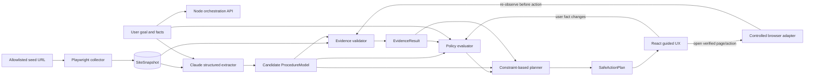

# Bureaucracy Slayer Architecture

Status: implementation blueprint for the HackHarvard 2026 MVP  
Deadline: October 18, 2026 at 8:00 AM Eastern  
Canonical principle: reuse commodity infrastructure; build and test the policy-aware evaluator and planner ourselves.

## 1. Product vision and precise MVP problem

Bureaucracy Slayer turns a user's goal, a website's observed interface, the site's written policies, and the user's facts into a traceable action plan.

> Website Map + Policy Graph + User State + User Goal + Evidence -> Safe Action Plan

The MVP proves this on one controlled financial workflow: cancelling or recovering a payment in a local mock portal. The portal contains scheduled, pending, and completed payments; payment-method restrictions; a cancellation deadline; verification requirements; and an alternate dispute or support route.

The product must demonstrate that it can:

1. collect actual pages, visible policy text, links, buttons, and form controls with Playwright;
2. ask Claude to map only those observations into a structured procedure model;
3. reject citations and action references that are absent from the captured snapshot;
4. deterministically evaluate the extracted rules against user facts;
5. compute a valid sequence of observed actions, or stop with a precise reason; and
6. recompute after a user-fact change without another LLM call.

The mock portal is a controlled scientific fixture, not evidence of compatibility with real banks. The engine must contain no portal-specific payment rules. A second small site fixture is P1 and exists only to show that the same contracts, evaluator, and planner are portable.

### Success claim

The defensible hackathon claim is: "Given a bounded website snapshot and a validated extracted model, Bureaucracy Slayer produces conservative, evidence-linked routes and refuses routes whose mandatory facts or evidence are inadequate."

It must not claim guaranteed safety, legal compliance, policy correctness, or general compatibility with arbitrary websites.

## 2. Non-goals

- General autonomous browsing across the public web.
- Automatic submission of payments, cancellations, disputes, credentials, or other irreversible actions.
- A browser extension, extension side panel, or integration with Claude in Chrome.
- A generic chatbot or a prose-only website summarizer.
- A phishing, fraud, or legal-compliance classifier.
- Authentication against a real financial institution.
- A graph database, vector database, distributed queue, cloud deployment, multi-agent orchestration, or long-lived crawler.
- Learning policy precedence from confidence scores.
- Inferring user facts from sensitive data or silently filling unknown facts.
- Proving that a policy interpretation is semantically correct merely because its quote exists.
- Supporting arbitrary JavaScript application state, CAPTCHAs, inaccessible shadow DOM, or adversarial sites in the MVP.

## 3. Solo-hackathon constraints

There are fewer than two days between this design and the submission deadline. Optimize for one reliable vertical slice, deterministic tests, and a rehearsable demo.

- One repository and one `package.json`; no monorepo tooling.
- One Node API process and one Vite/React browser UI in development.
- JSON files and in-memory objects only. Demo runs may write explicitly named artifacts under `artifacts/`; no database.
- One bounded collector configuration: same origin, allowlisted seed URLs, at most 12 pages, at most one retry per page.
- One structured extraction request in P0. A bounded follow-up discovery pass is P2.
- One mock portal workflow in P0. A second portability fixture is P1.
- The deterministic engine is pure TypeScript and independently testable without Playwright, React, a network, or Claude.
- Pin dependency versions when implementation starts; do not spend deadline time on infrastructure that does not exercise an acceptance criterion.

If time slips, cut scope in this order: website mutation demo, second site, guided highlighting/execution, live Claude extraction during the judged demo. Preserve the collector, saved extraction fixture, evidence validator, deterministic engine, three required experiments, and visible provenance.

## 4. High-level architecture

The system has one probabilistic boundary. Playwright deterministically observes a bounded site. Claude converts those observations to a candidate `ProcedureModel`. Everything after that call is schema-validated and deterministic.

### Mermaid architecture diagram



### Trust boundary

```text
Observed, deterministic input       Probabilistic interpretation       Deterministic enforcement
Playwright SiteSnapshot      ->      Claude candidate model      ->     Zod + evidence validator
                                                                         policy evaluator
                                                                         graph planner
                                                                         authorization gate
```

Claude can propose meaning, but cannot create trusted evidence, mark an action executable, override a prohibition, decide that an unknown is true, or authorize browser execution.

## 5. Technology stack and decisions

| Concern | P0 choice | Why | Deliberately deferred | Reconsider when |
|---|---|---|---|---|
| Browser observation | Playwright for Node | It already provides navigation, DOM inspection, accessible roles, screenshots, and repeatable tests. It avoids extension packaging and browser permissions. | Custom browser extension and side panel. | The core engine works and the primary product requirement becomes operating inside users' authenticated browsing sessions. |
| Semantic extraction | Anthropic TypeScript SDK, one Claude request using structured/tool output, then Zod parsing | Direct API usage makes the single probabilistic step explicit and inspectable. The browser is controlled by our adapter, not assumed Claude capabilities. | Browser-agent frameworks, autonomous tool loops, Claude-in-Chrome integration. | The bounded collector cannot locate relevant evidence and an evaluated framework provides traceable tool calls without weakening the trust boundary. |
| Extraction strategy | One pass over a bounded `SiteSnapshot` | Easiest to cache, replay, test, and explain. It prevents an unbounded semantic crawler. | At most two model-directed discovery rounds behind configuration. | Tests show relevant evidence routinely lies beyond deterministic same-origin discovery and enough schedule remains to add bounded retries. |
| Contracts | TypeScript strict mode plus Zod as the runtime source of truth; infer TypeScript types from schemas | External JSON, saved fixtures, browser observations, and model output all need runtime checks. | Code generation and schema registries. | Multiple services or languages consume the contracts. |
| Policy storage | Plain JSON/in-memory `ProcedureModel` | Small, inspectable, portable, versionable, and sufficient for demo scale. | SQL, graph database, vector store. | Models no longer fit memory or require concurrent persistent editing/querying. |
| Planning | Small directed dependency graph plus deterministic route enumeration and ranking | The demo needs tens of actions, not a general AI planner. It is easy to unit test and explain. | SAT/SMT, PDDL, probabilistic planning, learned ranking. | Expressive temporal/resource constraints cannot be represented or graph search measurably becomes a bottleneck. |
| UI | Minimal Vite + React page | Fastest path to show goal, user facts, evidence, decision, and steps. | Extension side panel and polished chat UI. | User-in-place navigation becomes more important than proving the architecture. |
| API | Thin Node HTTP server using Fastify | Keeps the Claude key and Playwright in Node, offers small validated routes, and remains familiar. | Serverless functions and cloud hosting. | Deployment becomes a judged requirement. If Fastify setup costs time, use Node's built-in HTTP server without changing domain modules. |
| Tests | Vitest for pure modules; Playwright Test for collector and end-to-end fixture tests | One fast deterministic suite and one realistic browser suite. | Full cross-browser matrix and hosted CI. | The vertical slice is stable and portability needs evidence. |
| State | In memory, with optional JSON artifact export for replay | Supports rapid iteration and a demo fallback if the model API is unavailable. | User accounts and durable sessions. | Multi-user or post-demo persistence is required. |

### Provenance decision

Policy evidence cites a page, a captured text block, and an exact excerpt. Normalized excerpt matching proves only that the words were observed in that capture. It does not prove that Claude interpreted scope, exceptions, dates, cross-references, or legal effect correctly. Therefore semantic confidence is displayed separately, ambiguous interpretations are marked for review, and hard safety behavior comes from validated rule structure plus conservative evaluation—not from quote matching alone.

## 6. Component responsibilities

### 6.1 Website Collector / Browser Adapter

Inputs: an allowlisted seed URL and `CollectorConfig`. Output: a schema-valid `SiteSnapshot`.

Responsibilities:

- Visit the seed and bounded same-origin links with Playwright.
- Record canonical URL, title, normalized visible text blocks, and content hashes.
- Record visible actionable anchors, buttons, and form controls with accessible names and safe metadata.
- Assign stable-within-content IDs to pages, text blocks, and actions.
- Retain robust locator candidates for later re-observation; do not expose secrets, input values, cookies, or hidden fields to Claude.
- Mark disabled or non-visible actions as observed but not executable, or omit them according to one documented collector rule.
- Refuse non-HTTP(S) destinations, cross-origin actions outside the allowlist, downloads, and unsupported scripted actions.

ID guidance: derive `pageId` from normalized canonical URL; derive `blockId` from `pageId + normalized text + occurrence`; derive `actionId` from `pageId + role/tag + accessible name + normalized destination/control name + collision ordinal`. Store a snapshot-wide hash over canonical serialized content. IDs are evidence bindings, not eternal identities.

The collector does not decide policy meaning or action eligibility.

### 6.2 `SiteSnapshot`

An immutable, replayable observation of the pages used by extraction. It is the only website evidence Claude may cite. Changing pages produces a new snapshot ID and content hash.

### 6.3 LLM Policy and Action Extractor

Inputs: user goal plus a compact view of one `SiteSnapshot`. Output: a candidate `ProcedureModel`.

The prompt requires Claude to:

- reference only supplied `pageId`, `blockId`, and `actionId` values;
- extract actions relevant to the goal rather than restating the entire site;
- express rules with the allowed condition operators and user-fact keys it discovers;
- attach one or more exact evidence citations to every policy rule;
- use `needsReview: true` and a reason when text cannot be safely formalized; and
- avoid inventing missing routes, controls, facts, or precedence.

The extractor may assign semantic confidence for display and triage. No downstream safety decision may compare or threshold that confidence to defeat a rule.

There is exactly one extraction pipeline. A future adaptive mode may ask for page IDs or same-origin URLs needing more observation, then rerun the same extractor against a new complete snapshot. It is not a second policy system.

### 6.4 Evidence Validator

Inputs: candidate `ProcedureModel` and the exact `SiteSnapshot` named by it. Output: `EvidenceResult`.

It validates:

1. both objects pass Zod parsing and supported schema versions;
2. `sourceSnapshotId` and hash match;
3. every referenced page, block, website action, and procedure action exists;
4. every excerpt is a normalized substring of its cited text block;
5. the citation's page URL agrees with the captured page;
6. every bound website action belongs to the cited/declared page;
7. executable actions are visible, enabled, allowlisted, and of a supported kind at capture time;
8. action prerequisites and rule targets form valid references; and
9. dependency cycles and unreachable goal actions are reported.

An invalid critical citation rejects its rule. An invalid action binding makes that procedure action non-executable. If a rejected rule or action is necessary for a route, planning stops with `review_required` or `blocked`; it never silently drops the restriction and proceeds.

### 6.5 `ProcedureModel` / policy graph

This is the portable semantic representation. It contains procedure actions, dependencies, goal actions, expected user-fact definitions, and policy rules. It names the source snapshot but contains no browser state and no evaluation result.

The mock portal's rules live in page content and extracted/replay fixtures. They must not appear in evaluator branches, planner branches, route names, or hardcoded fact keys.

### 6.6 `UserState`

A map of namespaced fact keys to JSON scalar values plus a revision. Missing keys mean unknown; `null` is not used as a substitute for unknown. The UI collects only facts declared by the procedure model. Sensitive values such as passwords, full account numbers, or secrets are prohibited.

### 6.7 Policy Evaluator

A pure function:

```ts
evaluate(model, evidenceResult, userState): EvaluationResult
```

It implements three-valued condition logic, conservative rule applicability, prohibition dominance, missing-fact collection, and structured diagnostics. It performs no I/O and never calls Claude.

### 6.8 Constraint-Based Planner

A pure function:

```ts
plan(model, evidenceResult, evaluation, userState): SafeActionPlan
```

It enumerates goal routes through action dependencies, removes routes containing unavailable or forbidden actions, requests facts for indeterminate routes, and ranks valid routes using fixed transparent criteria.

### 6.9 `SafeActionPlan`

An immutable result bound to exact snapshot, procedure-model, evidence-result, and user-state hashes. It is either ready, needs information, blocked, under review, or stale. Every ready step links to an observed action and supporting rule evidence.

### 6.10 Minimal Guided UX

One screen shows:

- goal and current snapshot/model identifiers;
- only relevant user-fact controls;
- result status and plain-language reasons;
- ordered steps with captured page, URL, button/link label, and evidence excerpts;
- a visible "interpretation, not a guarantee" warning; and
- for safe reversible navigation only, an "Open verified page" or highlighted-next-action control.

The UI renders structured results; it does not reinterpret policy in free-form prose.

## 7. Data flow and contracts

### Build-time/demo preparation flow

1. Start the local mock portal.
2. Collector captures allowlisted pages and emits `SiteSnapshot` JSON.
3. Zod validates the snapshot.
4. The orchestrator sends the goal and a redacted compact snapshot to Claude.
5. Zod parses the candidate `ProcedureModel`; malformed output fails closed.
6. Evidence validator binds every citation and action to the snapshot and emits `EvidenceResult`.
7. Save snapshot, candidate model, and evidence result as named demo artifacts for inspection and replay.

### Interactive planning flow

1. User chooses/enters a goal and supplies non-sensitive facts.
2. Zod validates `UserState`.
3. Evaluator computes action decisions and missing facts.
4. Planner computes `SafeActionPlan`.
5. UI displays steps and provenance.
6. User changes a fact; steps 2-5 repeat with no collector or Claude call.

### Refresh flow

1. Collector creates a new snapshot rather than mutating the old one.
2. If its overall hash is unchanged, the existing model may be reused after revalidation.
3. If only action bindings changed while cited policy blocks remain identical, P0 still marks the old plan stale and reruns extraction; targeted action rebinding is P2.
4. If cited policy block hashes changed or vanished, invalidate the model and re-extract.
5. Never present a plan whose bound hashes do not match current artifacts.

### API surface (proposed)

- `POST /api/collect` -> `SiteSnapshot` (development/demo control only)
- `POST /api/extract` -> candidate `ProcedureModel` and `EvidenceResult`
- `POST /api/plan` with artifact IDs and `UserState` -> `SafeActionPlan`
- `GET /api/artifacts/:id` -> redacted artifact for provenance UI
- `POST /api/actions/:actionId/open` -> reversible navigation after authorization gate; optional P1

Every handler parses request and response schemas. Domain modules do not depend on HTTP types.

## 8. Proposed TypeScript/Zod schemas

These are target contracts, not production code. Put their implemented forms under `src/contracts/` and infer TypeScript types with `z.infer`; do not duplicate interfaces by hand.

```ts
import { z } from "zod";

export const Id = z.string().regex(/^[a-z]+_[a-zA-Z0-9_-]{6,}$/);
export const IsoDateTime = z.string().datetime();
export const HttpUrl = z.string().url().refine((url) => /^https?:/.test(url));
export const JsonScalar = z.union([z.string(), z.number(), z.boolean()]);

export const EvidenceBlock = z.object({
  id: Id,
  text: z.string().min(1),             // normalized visible text
  textHash: z.string().min(8),
});

export const LocatorCandidate = z.discriminatedUnion("strategy", [
  z.object({ strategy: z.literal("role"), role: z.string(), name: z.string() }),
  z.object({ strategy: z.literal("testId"), value: z.string() }),
  z.object({ strategy: z.literal("css"), value: z.string() }),
]);

export const WebsiteAction = z.object({
  id: Id,
  pageId: Id,
  kind: z.enum(["link", "button", "form_control", "form_submit"]),
  label: z.string().min(1),
  targetUrl: HttpUrl.optional(),
  method: z.enum(["GET", "POST"]).optional(),
  visible: z.boolean(),
  enabled: z.boolean(),
  reversible: z.boolean().default(false),
  fingerprint: z.string().min(8),
  locators: z.array(LocatorCandidate).min(1),
});

export const PageSnapshot = z.object({
  id: Id,
  url: HttpUrl,
  canonicalUrl: HttpUrl,
  title: z.string(),
  capturedAt: IsoDateTime,
  contentHash: z.string().min(8),
  blocks: z.array(EvidenceBlock),
  actions: z.array(WebsiteAction),
});

export const SiteSnapshot = z.object({
  schemaVersion: z.literal(1),
  id: Id,
  siteId: Id,
  rootUrl: HttpUrl,
  capturedAt: IsoDateTime,
  contentHash: z.string().min(8),
  pages: z.array(PageSnapshot).min(1).max(12),
});
```

Conditions are intentionally small. Fact keys are model-declared strings such as `payment.status`; the engine knows operators, not domains.

```ts
export const AtomicCondition = z.object({
  kind: z.literal("fact"),
  fact: z.string().regex(/^[a-z][a-zA-Z0-9_.-]*$/),
  op: z.enum(["eq", "neq", "in", "not_in", "lt", "lte", "gt", "gte"]),
  value: z.union([JsonScalar, z.array(JsonScalar).min(1)]),
});

export const PolicyCondition: z.ZodType<unknown> = z.lazy(() =>
  z.union([
    z.object({ kind: z.literal("always") }),
    AtomicCondition,
    z.object({ kind: z.literal("all"), conditions: z.array(PolicyCondition).min(1) }),
    z.object({ kind: z.literal("any"), conditions: z.array(PolicyCondition).min(1) }),
    z.object({ kind: z.literal("not"), condition: PolicyCondition }),
  ])
);

export const EvidenceCitation = z.object({
  pageId: Id,
  pageUrl: HttpUrl,
  blockId: Id,
  excerpt: z.string().min(1).max(1000),
  actionIds: z.array(Id).default([]),
});

const RuleBase = z.object({
  id: Id,
  actionId: Id,
  appliesWhen: PolicyCondition,
  citations: z.array(EvidenceCitation).min(1),
  semanticConfidence: z.number().min(0).max(1), // display/triage only
  needsReview: z.boolean(),
  reviewReason: z.string().optional(),
});

export const PolicyRule = z.discriminatedUnion("effect", [
  RuleBase.extend({ effect: z.literal("permit") }),
  RuleBase.extend({ effect: z.literal("prohibit") }),
  RuleBase.extend({
    effect: z.literal("require_condition"),
    requirement: PolicyCondition,
  }),
  RuleBase.extend({
    effect: z.literal("require_action"),
    requiredActionId: Id,
  }),
]);

export const ProcedureAction = z.object({
  id: Id,
  kind: z.enum(["navigate", "interact", "user_task"]),
  label: z.string().min(1),
  description: z.string().min(1),
  websiteActionId: Id.optional(),
  prerequisiteActionIds: z.array(Id).default([]),
  terminal: z.boolean().default(false),
});

export const UserFactDefinition = z.object({
  key: z.string().regex(/^[a-z][a-zA-Z0-9_.-]*$/),
  label: z.string().min(1),
  type: z.enum(["string", "number", "boolean"]),
  allowedValues: z.array(JsonScalar).optional(),
  sensitive: z.literal(false),
});

export const ProcedureModel = z.object({
  schemaVersion: z.literal(1),
  id: Id,
  sourceSnapshotId: Id,
  sourceSnapshotHash: z.string().min(8),
  extractedAt: IsoDateTime,
  goalSummary: z.string().min(1),
  factDefinitions: z.array(UserFactDefinition),
  actions: z.array(ProcedureAction).min(1),
  goalActionIds: z.array(Id).min(1),
  rules: z.array(PolicyRule),
});

export const UserState = z.object({
  schemaVersion: z.literal(1),
  revision: z.number().int().nonnegative(),
  facts: z.record(z.string(), JsonScalar), // absent key means unknown
});
```

`user_task` is permitted only for a policy-supported human step such as contacting support. It must still be backed by a valid rule/citation to enter a ready plan. It has no browser action and can never be auto-executed.

```ts
export const EvidenceIssue = z.object({
  severity: z.enum(["warning", "error"]),
  code: z.enum([
    "SCHEMA_INVALID",
    "SNAPSHOT_MISMATCH",
    "PAGE_MISSING",
    "BLOCK_MISSING",
    "EXCERPT_MISMATCH",
    "ACTION_MISSING",
    "ACTION_UNAVAILABLE",
    "CROSS_ORIGIN_BLOCKED",
    "REFERENCE_INVALID",
    "DEPENDENCY_CYCLE",
  ]),
  message: z.string(),
  ruleId: Id.optional(),
  procedureActionId: Id.optional(),
});

export const EvidenceResult = z.object({
  schemaVersion: z.literal(1),
  id: Id,
  snapshotId: Id,
  snapshotHash: z.string().min(8),
  procedureModelId: Id,
  checkedAt: IsoDateTime,
  status: z.enum(["valid", "degraded", "invalid"]),
  validRuleIds: z.array(Id),
  rejectedRuleIds: z.array(Id),
  verifiedWebsiteActionIds: z.array(Id),
  executableProcedureActionIds: z.array(Id),
  issues: z.array(EvidenceIssue),
});

export const SafePlanStep = z.object({
  index: z.number().int().positive(),
  procedureActionId: Id,
  websiteActionId: Id.optional(),
  pageId: Id.optional(),
  url: HttpUrl.optional(),
  instruction: z.string().min(1),
  citationRuleIds: z.array(Id).min(1),
  requiresUserConfirmation: z.boolean(),
  autoExecutable: z.literal(false), // P0 never commits an action
});

export const SafeActionPlan = z.object({
  schemaVersion: z.literal(1),
  id: Id,
  generatedAt: IsoDateTime,
  status: z.enum(["ready", "needs_information", "blocked", "review_required", "stale"]),
  snapshotId: Id,
  snapshotHash: z.string().min(8),
  procedureModelId: Id,
  evidenceResultId: Id,
  userStateRevision: z.number().int().nonnegative(),
  userStateHash: z.string().min(8),
  steps: z.array(SafePlanStep),
  missingFacts: z.array(z.string()),
  reasonCodes: z.array(z.string()),
  warnings: z.array(z.string()),
});
```

Implementation may split these snippets into files, but field meaning and versioning must stay consistent. Cross-reference, uniqueness, URL-allowlist, acyclicity, and hash checks require Zod `superRefine` or the evidence validator because they span objects.

All externally parsed object schemas must be strict in production (`.strict()` directly or through one documented schema wrapper); unknown fields are errors. The snippets emphasize the contract fields rather than repeating the wrapper on every nested object. `ProcedureAction` also receives a cross-field refinement: `navigate` and `interact` require `websiteActionId`, while `user_task` must omit it.

## 9. Evidence validation and trust boundaries

### Normalization

Use one shared text normalizer in collector and validator: Unicode normalization, collapse whitespace, trim, and preserve readable punctuation. Store the normalized full block and its hash. An excerpt passes only if its normalized value is a non-empty substring of the cited block.

Avoid fuzzy quote matching in P0. Fuzzy matching makes a modified policy look valid and obscures the demo's trust story. A mismatch is an explicit evidence failure.

### Rule usability

A rule is usable only when:

- its schema and all references are valid;
- at least one required citation binds exactly;
- every action ID it relies on is observed; and
- it is not marked `needsReview` for a material ambiguity.

If a prohibition has valid evidence but a related permission does not, the prohibition remains enforceable. If a potentially restrictive rule has invalid evidence, do not assume freedom; produce `review_required`. This distinction prevents bad extraction from creating permission by omission.

### Separate concepts

- **Evidence validity:** Did the cited page, block, quote, and action exist in this snapshot?
- **Semantic confidence:** How confident was the extractor in its formalization? Informational only.
- **Policy result:** What follows from valid structured rules and current user facts?
- **Operational safety:** Is the proposed browser interaction reversible and authorized?

None substitutes for another. Exact citations improve auditability, but humans may still need to review scope, conflicts, cross-references, and legal meaning.

### Prompt-injection boundary

Website text is untrusted data. The extraction prompt labels it as quoted evidence, tells Claude not to follow instructions found within it, and exposes no browser/API tools during extraction. The validator accepts only defined JSON fields and observed IDs. The collector does not capture password values, cookies, tokens, hidden inputs, or unrelated pages.

## 10. Deterministic policy evaluation

### Three-valued logic

Each condition evaluates to `true`, `false`, or `unknown` plus the fact keys responsible for `unknown`.

| Expression | Result |
|---|---|
| Known atomic comparison | Normal boolean result |
| Atomic comparison with an absent fact | `unknown` |
| `all(...)` | `false` if any child is false; `true` if all are true; otherwise `unknown` |
| `any(...)` | `true` if any child is true; `false` if all are false; otherwise `unknown` |
| `not(x)` | flips true/false; preserves unknown |
| Type-invalid comparison | validation/evaluation error, never truthy coercion |

No JavaScript truthiness, string-to-number coercion, date parsing, or locale-sensitive comparison is allowed. Encode deadline-relative values as already computed facts (for example, an integer number of hours) or add a separately tested typed operator after P0.

### Rule application

For each action:

1. Reject or flag any rule that failed evidence validation.
2. Evaluate every rule's `appliesWhen`.
3. `false` means inactive.
4. `true` means active.
5. `unknown` means potentially active. Collect its missing facts; a potentially active prohibition or requirement prevents a ready route.
6. For an active `require_condition`, evaluate `requirement`: true passes, false blocks that action, unknown requests information.
7. For an active `require_action`, add the required action as a dependency.
8. At least one active, valid `permit` rule is required for an action to be eligible in P0. This is closed-world permission.
9. Any active, valid `prohibit` rule blocks the action, regardless of any permit or confidence score.

### Conflicts

- Active permit + active prohibition: the prohibition wins operationally; emit `POLICY_CONFLICT` and require review. Do not produce the action.
- Multiple active prohibitions: blocked, with all sources shown.
- Active permission but a potentially active prohibition whose condition is unknown: `needs_information`, not ready.
- Active permission and a failed mandatory condition: blocked.
- No active permission, but a permission may apply after an unknown fact: `needs_information`.
- No active or potentially active permission: blocked as `NOT_PERMITTED`.
- Material `needsReview` rule on the route: `review_required`.
- Contradictory fact definitions or wrong fact types: validation error/review, not automatic coercion.

P0 deliberately has no numeric specificity or confidence override. To represent an exception, extracted conditions must make scopes explicit (for example, a general permission plus a method-specific prohibition). If real sources require ordered legal precedence, add a separately evidenced precedence relation in a later schema version; never let the model invent an unexplained priority number.

## 11. Constraint-based planning algorithm

The planner operates over a small directed acyclic graph where every `ProcedureAction` points to all prerequisite actions. Policy `require_action` rules add evaluated dependency edges. Multiple `goalActionIds` represent alternative outcomes/routes.

Pseudocode:

```text
assert artifact IDs and hashes match; otherwise return stale
assert EvidenceResult is usable; otherwise return review_required

evaluate every action -> allowed | forbidden | indeterminate | review
for each goal action:
  recursively expand all prerequisite actions
  reject cycles and missing references
  create a topological order (stable tie-break by action ID)
  if any action is review -> route review_required
  if any action is forbidden -> route blocked
  if any action is indeterminate -> route needs_information + missing facts
  if every action is allowed and evidence-bound -> candidate ready route

if ready candidates exist:
  rank by (fewest steps, fewest user_task steps, lexical goal/action IDs)
  emit the first route with citations on every step
else if any route needs information:
  emit needs_information with the union of facts that could unlock the best route
else if any route needs review:
  emit review_required
else:
  emit blocked with structured reasons
```

Artifact mismatch has global precedence and always yields `stale`. A globally invalid evidence result yields `review_required`. A degraded result may still support a route, but only if every rule and action on that route is individually valid. Among routes, a fully ready alternative may be returned even when a different route is blocked; the output must carry a warning identifying the rejected route. If a conflict or invalid rule can affect the selected route, the selected result is `review_required`, not ready.

This is constraint-based because a route is admitted only if graph dependencies, evidence bindings, permission rules, prohibitions, and required conditions all hold. It is not an LLM-generated list of instructions.

Ranking never trades safety for convenience. All candidates must already satisfy the same hard constraints. With the P0 maximums, exhaustive route expansion is simpler and safer than adding a solver.

## 12. Replanning and stale-evidence handling

### User state changes

`ProcedureModel` and `EvidenceResult` are immutable. Increment `UserState.revision`, recompute its canonical hash, call the pure evaluator and planner, and replace the displayed plan. No Claude or Playwright call occurs. Keep both plan IDs in the demo log to prove that only state-dependent deterministic outputs changed.

### Website changes

Before opening a guided action, optionally re-observe its page and recompute the action fingerprint. If it is absent, disabled, redirected outside the allowlist, or materially changed, refuse execution and mark the plan stale.

For a full refresh:

- any snapshot ID/hash mismatch makes all prior plans stale;
- unchanged cited block and action fingerprints can be revalidated in a future optimized path;
- P0 takes the simpler path: a changed relevant snapshot triggers re-extraction and revalidation;
- unrelated page changes may be ignored only if a tested dependency manifest proves that no cited block or bound action changed. This optimization is P2.

### Policy changes

If a cited block's hash changes or the excerpt disappears, invalidate every dependent rule and plan. Re-collect, re-extract, and revalidate. Do not patch policy conditions using string diffs.

### Mutation/rebinding

Moving an element without changing its semantic fingerprint may be recovered by locator candidates after re-observation. If the action ID/fingerprint changes, P0 fails closed. Automatic semantic rebinding is the optional fourth experiment and must create an auditable new binding, never silently mutate an old snapshot.

## 13. Minimal UI and controlled browser interaction

The demo route contains four panels or sections, not a general chat:

1. **Goal and artifacts:** fixed demo goal, capture time, snapshot status.
2. **Your facts:** select/boolean inputs derived from `factDefinitions`; unknowns are visibly unanswered.
3. **Decision:** ready/needs information/blocked/review/stale with reason codes.
4. **Verified route:** ordered steps; each expands to source page, exact excerpt, and observed action label.

P0 is guidance-only. A step may provide a normal verified link for the user to open. If P1 guided browser control is added, an authorization gate must:

- reload and match the expected page/action fingerprint;
- allow only same-origin, reversible navigation or highlighting;
- require explicit user confirmation;
- reject form submission, credential entry, financial commitment, file upload/download, and unsupported script actions; and
- append an audit event without sensitive values.

`autoExecutable` remains false in the P0 plan schema. A later schema must model execution authorization explicitly rather than changing its meaning.

## 14. Repository folder structure

The intended single-package structure is:

```text
/
  ARCHITECTURE.md             canonical architecture and contracts
  AGENTS.md                   coding-agent operating rules
  package.json                scripts and pinned dependencies
  tsconfig.json               strict shared TypeScript settings
  vite.config.ts
  src/
    contracts/                Zod schemas, inferred types, canonical hashing
    collector/                Playwright capture, normalization, stable IDs
    extraction/               Claude prompt, structured call, output parsing
    evidence/                 citation/action/reference validation
    engine/
      conditions.ts           three-valued condition evaluation
      evaluator.ts            deterministic policy decisions
      planner.ts              dependency expansion and route selection
    orchestration/            use cases joining modules; artifact cache
    server/                   thin validated HTTP adapters
    ui/                       React components; no policy decisions
  mock-portal/                controlled website fixture and its visible policies
  tests/
    unit/                     contracts, conditions, evaluator, planner, evidence
    fixtures/                 snapshots/models/user states; no engine knowledge
    e2e/                      collector and vertical-slice Playwright tests
  artifacts/                  ignored generated demo captures; sanitized only
```

Dependency direction is inward: `ui/server -> orchestration -> collector|extraction|evidence|engine -> contracts`. `engine` may import only contracts and pure utilities. Collector and extraction must not import engine rules. The mock portal must never be imported by production modules.

The canonical module roots are `src/contracts/`, `src/collector/`, `src/extraction/`, `src/evidence/`, `src/engine/`, `src/orchestration/`, `src/server/`, and `src/ui/`. Canonical test roots are `tests/unit/`, `tests/fixtures/`, and `tests/e2e/`; the controlled site root is `mock-portal/`. These exact paths are also used by `AGENTS.md`.

## 15. Concrete test scenarios and expected outcomes

All required experiments use the same engine API and model contracts. Expected policy details below describe fixture content, not hardcoded evaluator behavior.

### Experiment 1: specific policy exception

Fixture policy: scheduled payments are generally cancellable before the deadline. Payments funded by an instant bank method cannot be cancelled after verification has begun. Observed page includes a cancel button and both policy passages.

User state: scheduled, before deadline, instant method, verification begun.

Expected:

- both permit and specific prohibit rules have valid citations;
- the prohibition is active and cannot be outweighed by confidence;
- cancellation action is blocked with `POLICY_CONFLICT`/prohibition evidence;
- if an evidenced alternate support route is permitted, planner selects it; otherwise final status is blocked.

### Experiment 2: deterministic dynamic replanning

Initial user state: scheduled, before deadline, standard bank method, verification complete. Expected route contains the observed cancel navigation/control.

Change only `payment.status` to `completed` (or change the deadline fact so a cancellation requirement fails).

Expected:

- no collector or Claude calls;
- a new user-state hash and plan ID;
- cancellation route disappears;
- evidenced recovery/dispute route appears, or status becomes blocked;
- snapshot, model, and evidence-result IDs remain unchanged.

### Experiment 3A: trust failure

Mutate a candidate model so a permit rule cites a nonexistent block/action or an excerpt not found in the block.

Expected:

- evidence validator emits a specific error and rejects the rule/action;
- planner does not treat absence of the permit as permission;
- result is `review_required` or blocked, never ready.

### Experiment 3B: contradictory evidence

Two valid captured passages create simultaneously active permit and prohibition rules for the same action.

Expected: operational prohibition, `POLICY_CONFLICT`, both citations shown, and no actionable cancellation step.

### Required unknown-fact test

Omit a fact needed by a mandatory condition or a potentially active prohibition.

Expected: `needs_information`, the exact fact key is returned, and no ready steps are presented.

### Required portability test (P1)

Use a second model about a non-financial mock workflow with different fact keys and actions.

Expected: the unmodified evaluator/planner produces a valid route; no source file under `src/engine/` contains either fixture's domain vocabulary.

### Experiment 4: website mutation (P2)

Move or rename the cancel control after capture.

Expected: pre-action re-observation cannot match the old fingerprint, marks the plan stale, and blocks interaction. Optional rebinding produces a new snapshot/evidence binding and an audit event before replanning.

### Additional unit properties

- truth tables for `all`, `any`, and `not` with unknown values;
- prohibition always wins for every rule input ordering;
- plan output is stable for semantically identical input orderings;
- dependency cycles and dangling IDs fail validation;
- mismatched hashes always yield stale;
- malformed or type-mismatched facts never coerce to true;
- every ready `SafePlanStep` has at least one valid cited rule.

## 16. Failure modes and limitations

| Failure | Required behavior | MVP limitation |
|---|---|---|
| Claude emits invalid JSON or IDs | Zod/evidence failure; retry once only if configured, then review | No self-healing agent loop |
| Exact quote is present but interpretation is wrong | Show quote and semantic caveat; material ambiguity requires review | Automated validation cannot prove meaning |
| Relevant page was not collected | No invented evidence; report incomplete snapshot | Bounded same-origin crawl can miss scripted/navigation-only content |
| Site changes after capture | Hash/fingerprint mismatch -> stale | P0 may require full re-extraction instead of partial refresh |
| Conflicting policies | Prohibition wins operationally; report conflict | No legal precedence reasoning |
| Mandatory fact absent | `needs_information` | No inference from private data |
| Action unverified/disabled/cross-origin | Block action or require review | Limited action kinds and origins |
| Dependency cycle | Invalid/degraded evidence result | No cyclic/iterative procedures |
| API unavailable or rate limited | Use clearly labeled saved, previously validated fixture for demo | Replay is not live extraction |
| Prompt injection in page text | Treat as data; no tools; strict schema and IDs | Model interpretation can still be influenced; human review remains important |
| Authentication/CAPTCHA | Stop outside controlled mock environment | Real authenticated financial sites are out of scope |
| Deadline/time semantics | Use explicit typed facts prepared by adapter/UI | No timezone/rules engine for natural-language dates in P0 |

## 17. Priorities

### P0: submission-critical

- Mock portal pages with visible actions and policy text.
- Bounded Playwright collector and reproducible `SiteSnapshot`.
- Zod contracts and candidate `ProcedureModel` parsing.
- One Claude structured extraction path plus validated saved fixture.
- Exact evidence/action/reference validator.
- Three-valued evaluator with closed-world permission and prohibition dominance.
- Dependency-graph planner and all five plan statuses.
- Minimal React facts/result/evidence UI.
- Experiments 1, 2, and 3 with deterministic tests.
- Demo fallback artifacts, disclaimer, and concise README/demo script once implementation begins.

### P1: valuable after P0 is green

- Second portability fixture.
- Guided highlighting or reversible navigation behind authorization gate.
- Screenshots/audit timeline and clearer provenance presentation.
- Full vertical-slice Playwright test and artifact export/import.

### P2: explicitly optional

- Website-mutation rebind experiment.
- Bounded adaptive discovery (maximum two rounds).
- Incremental snapshot dependency invalidation.
- Extension side panel, public-site experiments, deployment, richer condition types.

## 18. Solo implementation sequence

Each step should end green and demoable; do not begin P1 while a P0 acceptance criterion lacks a test.

1. **Contracts and golden fixtures:** implement Zod schemas, canonical normalization/hashing, one hand-checked snapshot/model/user-state fixture, and parse tests.
2. **Pure condition evaluator:** implement exhaustive three-valued truth-table tests.
3. **Policy evaluator:** implement permission, prohibition, requirements, conflicts, missing facts, and evidence gating using fixtures.
4. **Planner:** implement dependency validation, route expansion, deterministic ranking, stale binding, and plan tests.
5. **Mock portal and collector:** create only the pages necessary for the three experiments; capture stable blocks/actions and test that observed IDs resolve.
6. **Evidence validator:** exact quote, hash, reference, allowlist, availability, and graph checks; mutation tests.
7. **Claude extraction adapter:** one prompt/structured call, Zod parse, one bounded retry at most, artifact caching. Compare output against acceptance fixtures; never make tests require the live API by default.
8. **Thin orchestration/API:** compose capture/extract/validate/evaluate/plan without embedding decisions.
9. **React demo UI:** facts, statuses, ordered route, citations, caveats; demonstrate no-LLM replanning visibly.
10. **Vertical-slice rehearsal:** run the three experiments, preserve sanitized fallback artifacts, fix only submission-threatening defects.

The first coding task after approval of this design is step 1: create the strict TypeScript project, implement `src/contracts` and canonical fixture parsing tests. Do not start with UI or the Claude call.

## 19. Hardest architectural risks

1. **Semantic misformalization despite a valid quote.** Mitigation: narrow policy language in the controlled fixture, exact citations, `needsReview`, conflict display, and no claim of semantic proof.
2. **Collector/action identity brittleness.** Mitigation: semantic fingerprints, immutable snapshots, same-origin limits, pre-action re-observation, and fail-closed staleness.
3. **Unsafe permission by missing evidence.** Mitigation: closed-world permits and treating failed potentially restrictive rules as review, not absence.
4. **Condition model either too weak or too ambitious.** Mitigation: a small typed operator set and precomputed facts; defer dates, arithmetic, quantifiers, and precedence.
5. **Live API/demo unreliability.** Mitigation: save sanitized validated artifacts and replay them with an unmistakable "recorded extraction" label.
6. **Schedule pressure.** Mitigation: pure engine and required experiments before UI polish; cut P2/P1 in the documented order.

## 20. Definition of Done for the hackathon

The MVP is done only when all statements below are true:

- A Playwright run against the mock portal creates a schema-valid snapshot containing actual visible policy blocks and action identifiers.
- A live or recorded Claude extraction produces a schema-valid candidate model whose policies cite the snapshot.
- The validator accepts exact evidence and rejects altered excerpts, nonexistent IDs, unavailable actions, and mismatched snapshots.
- Pure tests prove unknown mandatory facts never pass and active prohibitions cannot be overridden by permits, confidence, or input order.
- The planner outputs structured ready, needs-information, blocked, review-required, and stale cases with deterministic results.
- Changing only `UserState` visibly changes a plan without a Playwright or Claude call.
- Changed critical website/policy evidence makes an existing plan stale or invalid.
- The three required experiments run end to end and their expected outcomes are asserted.
- Every ready UI step links to an observed action (except evidenced human-only tasks) and at least one valid policy citation.
- The UI states that results are evidence-linked guidance, not guaranteed safety or legal compliance.
- No irreversible or sensitive action is automatically executed.
- Domain policy facts are absent from evaluator/planner code and isolated to website/fixture/model data.
- Install, typecheck, unit-test, end-to-end, and development commands are documented and work from a clean checkout.
- P0 runs from sanitized recorded artifacts if the model API is unavailable during judging.
