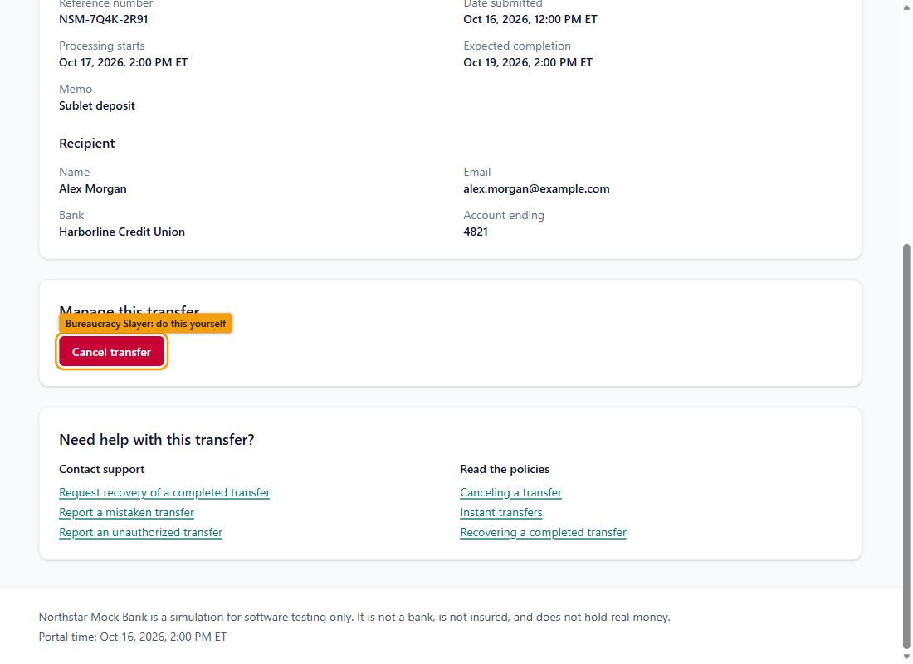
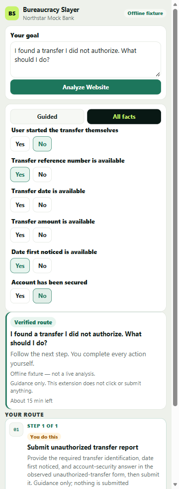
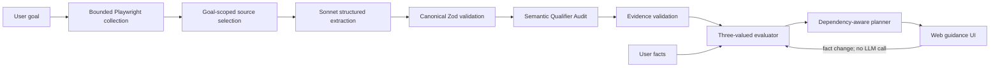
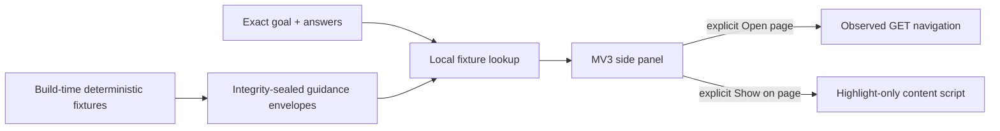

# Bureaucracy Slayer

> **AI agents know where to click. Bureaucracy Slayer verifies whether they should.**

Bureaucratic workflows rarely live on one page. Rules, exceptions, prerequisites, and forms are spread across a site, so plausible AI advice can still be unsupported—or unsafe. Bureaucracy Slayer places an evidence-first reasoning layer above an existing website: it captures a bounded view of the site, binds policy rules to exact source text and observed controls, evaluates those rules deterministically, and stops when permission cannot be verified.

This HackHarvard prototype contains:

- a React web application for collection, extraction, verification, personalization, and planning; and
- a Chrome/Edge side-panel extension that demonstrates fixture-backed, guidance-only navigation and highlighting on the fictional Northstar Mock Bank.

The project does **not** make real financial transactions, provide legal advice, or guarantee that an extracted policy model is semantically correct.



## Contents

- [Quick start: offline web demo](#quick-start-offline-web-demo)
- [How to use the web application](#how-to-use-the-web-application)
- [Three reproducible goals](#three-reproducible-goals)
- [Install and use the browser extension](#install-and-use-the-browser-extension)
- [How it works](#how-it-works)
- [Execution modes and provenance](#execution-modes-and-provenance)
- [Live Anthropic setup](#live-anthropic-setup)
- [Northstar Mock Bank](#northstar-mock-bank)
- [Testing](#testing)
- [Safety and limitations](#safety-and-limitations)
- [Troubleshooting](#troubleshooting)
- [HackHarvard demo walkthrough](#hackharvard-demo-walkthrough)
- [Project status and roadmap](#project-status-and-roadmap)

## Quick start: offline web demo

### Requirements

- Node.js `^20.19.0` or `>=22.12.0`, as declared in `package.json`
- npm
- Chromium for collector/browser tests
- Chrome 116+ or a current Microsoft Edge for the extension
- Windows, macOS, or Linux should be able to run the Node/Vite application; the documented commands below are verified for PowerShell on Windows

Install the root application and the independently versioned portal:

```powershell
npm.cmd install
npm.cmd --prefix mock-portal install
```

The deterministic offline demo uses three terminals. It does not require an API key.

**Terminal 1 — Northstar Mock Bank (`http://127.0.0.1:5180`)**

```powershell
npm.cmd run portal:dev
```

**Terminal 2 — deterministic mock API (`http://127.0.0.1:5190`)**

```powershell
npm.cmd run dev:mock-api
```

**Terminal 3 — web application (`http://127.0.0.1:5173`)**

```powershell
$env:BUREAUCRACY_SLAYER_EXECUTION_POLICY = 'offline_mock'
npm.cmd run dev:ui
```

Before analyzing, verify the mock through the same UI proxy:

```powershell
$probe = Invoke-WebRequest -UseBasicParsing 'http://127.0.0.1:5173/api/live-extraction/offline-mock'
if ($probe.StatusCode -ne 200) { throw 'Offline mock probe failed' }
if ($probe.Headers['x-bureaucracy-slayer-offline-mock'] -ne '1') { throw 'Offline mock marker missing' }
$body = $probe.Content | ConvertFrom-Json
if ($body.offlineMock -ne $true) { throw 'Wrong API target' }
```

Open `http://127.0.0.1:5173`. The application must say **Offline mock configured** before analysis and **Deterministic offline mock** after a result arrives.

This setup makes no Anthropic requests. Do not run `dev:server` or `test:live-extract` during an offline demonstration.

## How to use the web application

1. Open `http://127.0.0.1:5173`.
2. Confirm that the selected portal is `http://127.0.0.1:5180/dashboard` and is labeled as the fictional Northstar environment.
3. Enter one of the [supported offline goals](#three-reproducible-goals).
4. Select **Analyze Website**. In offline mode the UI exercises the real API contract and progress states, but receives a deterministic, goal-specific fixture—not a new Sonnet extraction.
5. Check the provenance banner before relying on the result.
6. In **Guided** view, answer one policy-relevant question at a time. Each answer immediately invokes only the local deterministic evaluator and planner.
7. Switch to **All facts** to inspect every declared fact. Change values, then select **Replan with updated facts**.
8. Read the decision:
   - **Safe route found**: every displayed step passed the deterministic checks and has accepted supporting evidence.
   - **More information needed**: a mandatory fact remains unknown.
   - **Human review required**: evidence, semantic ambiguity, or a policy conflict prevents a recommendation.
   - **No permitted route**: every candidate route was prohibited or otherwise unavailable.
9. Expand policy evidence and decision details to inspect exact excerpts, source links, rejected rules, and excluded actions.
10. Follow any resulting guidance manually. Every plan step requires user confirmation and has `autoExecutable: false`.

Changing facts does not require another LLM call because the procedure model has already been produced and validated. The evaluator applies three-valued logic to the new `UserState`, and the planner recomputes dependency closure locally.

If offline analysis reports that no grounded fixture exists, copy one of the exact goals below. Offline mode intentionally rejects unsupported wording instead of selecting a “close enough” procedure.

## Three reproducible goals

The offline web mock and the extension recognize these exact strings.

### A1 — scheduled cancellation

```text
Can I cancel my scheduled bank transfer?
```

Use **All facts** to set:

- **Transfer status:** Scheduled
- **Transfer type:** Standard
- **Transfer processing has begun:** No

Expected result: **Safe route found** for the observed cancellation action. Change **Transfer processing has begun** to **Yes** (or the transfer type to **Instant**) and the prohibition removes the route.

This demonstrates policy exceptions, prohibition dominance, observed-action binding, and deterministic replanning.

The offline result is a hand-checked deterministic fixture. The repository’s recorded Sonnet replay is tied to an older, broader goal and must not be described as a fresh A1 extraction.

### A2 — completed mistaken-transfer recovery

```text
I sent a completed transfer to the wrong recipient. How can I recover it?
```

Relevant facts include:

- **Transfer status:** Completed
- **Transfer processing has begun:** Yes
- **User started the transfer themselves:** Yes
- **Transfer type:** Standard

Expected result: **Human review required**. The source says completed self-initiated transfers *may be eligible* for recovery. The Semantic Qualifier Audit rejects the ambiguous recovery permit rather than converting it into unconditional permission.

This demonstrates goal-scoped source selection, required recovery information, exact evidence, and fail-closed semantic review. The deterministic A2 fixture preserves the same review gate, but it is still a fixture—not proof of a new Sonnet run. Other offline fixtures, such as the general verified cancellation fixture, do not represent this A2 state.

### A3 — unauthorized transfer

```text
I found a transfer I did not authorize. What should I do?
```

With no answers, expected result: **More information needed**. For the reference-number path, set:

- **User started the transfer themselves:** No
- **Transfer reference number is available:** Yes
- **Date first noticed is available:** Yes
- **Account has been secured:** either Yes or No

Expected result: **Safe route found** for the unauthorized-transfer report. “Account has been secured: No” is valid because the policy requires the user to answer whether the account is secured; it does not require the answer to be Yes.

An alternative identification path uses **Transfer date is available: Yes** and **Transfer amount is available: Yes** when no reference number is available. If **User started the transfer themselves** is Yes, the unauthorized-report action is prohibited; the activity must not be represented as unauthorized.

This demonstrates information requirements, alternative conditions, distinct unauthorized and mistaken-transfer procedures, and guidance-only submission.

The current offline fixture models required information as facts. The original saved Live A3 output modeled three information-gathering tasks as separately governed actions, so closed-world permission correctly blocked that original route. The extraction prompt has since been corrected for future runs, but no recording was rewritten and the fixture is not a fresh extraction.

## Install and use the browser extension

The extension is a Manifest V3, fixture-backed companion for Northstar. It is not synchronized with the web application and does not run collection, extraction, policy evaluation, or a backend request.

### Build and load

Start Northstar, then build the extension:

```powershell
npm.cmd run portal:dev
npm.cmd run build:extension
```

The unpacked extension is written to `extension/dist/`.

1. Open `chrome://extensions` in Chrome or `edge://extensions` in Edge.
2. Enable **Developer mode**.
3. Select **Load unpacked**.
4. Choose this repository’s `extension/dist` directory.
5. Open `http://127.0.0.1:5180/dashboard`.
6. Select the Bureaucracy Slayer toolbar action to open its side panel.

After rebuilding, return to the extensions page and select **Reload** on the unpacked extension. To uninstall it, select **Remove**. Reload the Northstar tab after reloading the extension so its content script is current.

### Current extension behavior

1. Type one of the three exact goals above.
2. Select **Analyze Website**.
3. Answer the displayed questions in **Guided** or **All facts** view.
4. Read the guidance status and route steps.
5. Use **Open page** only on a verified observed GET link. This navigates after an explicit click.
6. Use **Show on page** to highlight one unambiguous observed control. State-changing controls are labeled for manual action.
7. Use **Mark done** to advance the panel’s visual progress. It does not verify that the website action occurred.
8. Expand **View supporting evidence** to read the source excerpts attached to a step.

Despite its label, the extension’s **Analyze Website** button performs exact, trim-only lookup over prebuilt fixture envelopes. It makes no network request and does not inspect the current portal state. Any unsupported sentence fails closed with “This goal is not available in the offline demonstration.”

Editing an accepted goal to different text invalidates its route and removes navigation/highlight authority. Envelopes expire after about 15 minutes; expired, invalidated, superseded, malformed, tampered, or non-ready envelopes cannot navigate or highlight. **Developer / Demo controls** can load test scenarios, invalidate a session, clear a highlight, or reset the extension; they are not the normal goal workflow.

The extension never clicks **Cancel**, **Submit**, or any other sensitive control. Its content script can read visible control metadata, scroll, add a removable outline/badge, and clear that highlight. It cannot type, focus, submit, or dispatch page events.



## How it works

### What makes it different

- **Bounded website collection:** Playwright visits configured same-origin pages within explicit page, depth, and content limits.
- **Goal-scoped retrieval:** source selection retains pages, blocks, actions, and dependencies relevant to the requested outcome.
- **LLM-assisted structured extraction:** Sonnet proposes typed policy and procedure structures only from supplied observations.
- **Strict canonical contracts:** Zod parses snapshots, model output, API data, recorded artifacts, and plans at trust boundaries.
- **Evidence provenance verification:** every rule citation and browser-backed action must resolve to the captured snapshot.
- **Semantic Qualifier Audit:** a conservative local screen rejects permission rules whose cited qualifiers are not represented structurally.
- **Three-valued deterministic evaluation:** conditions resolve to true, false, or unknown; missing mandatory facts never become permission.
- **Dependency-aware planning:** the planner resolves action prerequisites and produces only evidence-supported routes.
- **Local replanning:** fact changes rerun deterministic evaluation and planning without collection or an LLM call.
- **Fail-closed outcomes:** unsupported goals, invalid evidence, ambiguous permissions, conflicts, and stale bindings do not produce ready steps.
- **Guidance only:** sensitive actions require the user to act manually.

Exact-quote validation proves provenance, not semantic correctness. A structured rule can still misunderstand the policy text; that is why semantic confidence, evidence validity, policy outcome, and operational safety remain separate.

### Web application architecture



Only the extraction step is probabilistic. Collection is bounded and observable; validation, evaluation, and planning are deterministic.

### Extension architecture



There is no implemented web-to-extension plan handoff. The extension accepts only its packaged `fixture_demo` envelopes for the Northstar loopback origin.

For deeper design details, see [ARCHITECTURE.md](ARCHITECTURE.md).

## Execution modes and provenance

| Mode | Policy model source | Anthropic called? | Deterministic? | Web/extension synchronization | Legitimate conclusion |
| --- | --- | --- | --- | --- | --- |
| Offline mock | Goal-specific, schema-valid test fixtures grounded in the recorded Northstar snapshot | No | API responses and downstream checks are deterministic | None | The API/UI contract and deterministic safety pipeline behave as shown for a supported fixture |
| Recorded Sonnet replay | Previously generated Sonnet bundle in `src/ui/generated/recordedSonnetBundle.ts` | No | Replay validation, evaluation, and planning are deterministic | None | A saved extraction still validates and produces the displayed result; it is not current website analysis |
| Live Sonnet extraction | Fresh bounded Northstar collection followed by two-stage structured extraction | Yes | Collection and enforcement are deterministic; model interpretation is not | None | The displayed run used a fresh snapshot and passed the implemented checks, not that its semantic interpretation is guaranteed |
| Extension fixture demo | Prebuilt, integrity-sealed guidance envelopes generated at extension build time | No | Exact lookup and envelope checks are deterministic | None | The extension can safely present, navigate, and highlight the packaged demonstration route |

The additional `verified_fixture` web policy is a hand-checked local cancellation fixture and makes no browser or model call. Provider selection is an operator startup policy, not a user-facing mode switch.

## Live Anthropic setup

> **Warning:** Live extraction sends captured, sanitized Northstar content to Anthropic and incurs API costs.

Do not expose credentials through `VITE_*` variables. Copy the server-only example and fill in a local, ignored `.env`:

```powershell
Copy-Item .env.example .env
notepad .env
```

Required values:

```dotenv
ANTHROPIC_API_KEY=your-local-key
ANTHROPIC_MODEL=claude-sonnet-4-5
ANTHROPIC_MAX_TOKENS=16000
COLLECTOR_TEST_URL=http://127.0.0.1:5180/dashboard
LIVE_EXTRACTION_MODE=goal_scoped
```

`ANTHROPIC_WORKSPACE_ID` is optional. Debug artifact saving is off by default; if enabled, choose a new path and do not commit sensitive output.

Run three terminals:

```powershell
# Terminal 1
npm.cmd run portal:dev
```

```powershell
# Terminal 2
$env:BUREAUCRACY_SLAYER_EXECUTION_POLICY = 'live'
npm.cmd run dev:server
```

```powershell
# Terminal 3
$env:BUREAUCRACY_SLAYER_EXECUTION_POLICY = 'live'
npm.cmd run dev:ui
```

Open `http://127.0.0.1:5173` and verify **Live website analysis** before selecting **Analyze Website**. The server binds to `127.0.0.1:5190`, owns the fixed allowed portal, performs bounded collection, and normally makes one structured policy-extraction request followed by one procedure-mapping request. This pipeline configures zero transient retries.

`npm.cmd run test:live-extract` is also a real, paid, opt-in extraction command. It is intentionally excluded from the normal test suite and should be run only with explicit authorization.

## Northstar Mock Bank

Northstar is fictional. It has no backend, authentication, or real money; state is stored in browser `localStorage`. Never enter real personal, banking, or credential information.

Its nine linked pages contain demonstration policy text, a transfer, help pages, and working simulated forms. The portal—not Bureaucracy Slayer—enforces its own test rules.

To restore the verified A1 scenario, open:

<http://127.0.0.1:5180/dashboard?scenario=a1-scheduled-standard>

The query parameter reseeds the scenario and is then removed from the address bar. This is the normal reset because a canceled transfer and submitted support cases persist in that browser’s portal storage.

See [the portal guide](mock-portal/README.md) for routes, scenarios, and ground truth.

## Testing

All normal tests are offline.

```powershell
# Root type checking and full Vitest suite
npm.cmd run typecheck
npm.cmd test

# Focused web UI and API integration suites
npm.cmd run test:ui
npm.cmd run test:live-integration

# Production builds
npm.cmd run build:ui
npm.cmd run portal:build

# Extension unit tests and package build
npm.cmd run test:extension
npm.cmd run build:extension
```

Install Chromium once before Playwright-backed collector or portal tests:

```powershell
npx.cmd playwright install chromium
npm.cmd --prefix mock-portal run test:e2e
```

For the extension’s visible browser verification, first build it and start Northstar, then run:

```powershell
npm.cmd run build:extension
npm.cmd run portal:dev
# In another terminal:
npm.cmd run verify:extension
```

The verifier launches installed Microsoft Edge by default, loads the unpacked extension, exercises goal input, personalization, highlighting, navigation, stale-session behavior, and safety checks, and refreshes screenshots under `extension/verification/screenshots/`. Set `$env:VERIFY_CHANNEL = 'chrome'` only to try branded Chrome; current branded Chrome releases may ignore command-line unpacked-extension loading.

## Safety and limitations

- Guidance is informational and manual. No plan step is automatically executable.
- The collector never authorizes actions; observed controls are provenance, not permission.
- Invalid or missing evidence, unknown mandatory facts, prohibitions, conflicts, and ambiguous permission fail closed.
- Deterministic enforcement cannot guarantee that Sonnet interpreted source language correctly.
- The local Semantic Qualifier Audit is conservative and intentionally incomplete; it is not natural-language entailment.
- Bounded collection and goal-scoped selection can miss material pages or text.
- Supported demonstrations are much narrower than arbitrary real websites.
- Northstar is a controlled scientific fixture, not evidence of compatibility with a real bank.
- Live extraction uses a server-held key, but it still sends selected page content to an external model provider.
- The extension is a fixture-backed prototype. It does not receive the web app’s current plan, re-observe policy, evaluate portal state, or contact a backend.
- Extension highlights can fail when the page or accessible control identity differs; ambiguous matches are refused.
- The project provides no production-grade banking authorization, compliance determination, safety guarantee, or legal advice.

## Troubleshooting

### Port 5180 is already in use

Northstar and the extension are fixed to `127.0.0.1:5180`. Identify the owner before stopping anything:

```powershell
netstat -ano | Select-String ':5180'
Get-Process -Id <PID> | Format-List Id,ProcessName,Path,StartTime
```

Stop only a process you recognize, then rerun `npm.cmd run portal:dev`.

### Port 5173 is already in use

The normal UI uses strict port 5173. For an offline-only rehearsal, use an isolated UI and mock API:

```powershell
# Mock API terminal
$env:BUREAUCRACY_SLAYER_MOCK_API_PORT = '5191'
npm.cmd run dev:mock-api

# UI terminal
$env:BUREAUCRACY_SLAYER_EXECUTION_POLICY = 'offline_mock'
$env:BUREAUCRACY_SLAYER_LIVE_API_ORIGIN = 'http://127.0.0.1:5191'
npm.cmd run dev:ui -- --port 5177
```

Then probe and open port 5177. Live API origin validation is fixed to the normal UI origin, so use port 5173 for Live extraction.

### Offline mock API is unavailable

Confirm `dev:mock-api` is running, then repeat the proxy probe from Quick Start. If using a non-default mock port, set `BUREAUCRACY_SLAYER_LIVE_API_ORIGIN` in the UI terminal before starting Vite.

### The offline goal is unsupported

Use one of the three exact goal strings. The mock and extension intentionally reject paraphrases and arbitrary goals because they have no grounded fixture for them.

### The extension does not appear

Confirm Developer mode is enabled, `extension/dist/manifest.json` exists, and `extension/dist`—not the repository root—was loaded. Build again, select **Reload** on the extensions page, refresh Northstar, and select the toolbar action.

### `extension/dist` does not exist

Run:

```powershell
npm.cmd run build:extension
```

### The extension says the route is invalidated, expired, or stale

Editing the goal invalidates the accepted route. Re-enter an exact supported goal and analyze again. For a full clean start, open **Developer / Demo controls** and select **Reset demo**. Reset the portal separately with the scenario URL when its state has changed.

### The transfer is already canceled or fixture state looks wrong

Visit:

<http://127.0.0.1:5180/dashboard?scenario=a1-scheduled-standard>

This reseeds Northstar without clearing unrelated browser storage.

### Playwright cannot find a browser

```powershell
npx.cmd playwright install chromium
```

The extension verifier uses installed Edge by default rather than the Playwright Chromium binary.

### Live Anthropic calls fail with a Windows certificate error

The server reports certificate failures without retrying. This repository does not implement a custom TLS-bypass workaround. Fix the machine or organization trust store, or ask the network administrator for the correct CA configuration. Do not disable TLS verification.

## HackHarvard demo walkthrough

A 90–120 second walkthrough:

1. **Frame the problem (10 seconds).** “LLMs can produce plausible instructions, but sensitive procedures need proof that an action is supported. AI agents know where to click; Bureaucracy Slayer verifies whether they should.”
2. **Show Northstar (10 seconds).** Open the fictional transfer and its policy links. Point out that rules and exceptions span several pages.
3. **A3 information-to-route (25 seconds).** In the offline web app, analyze the exact unauthorized goal. Show **More information needed**, answer that the user did not initiate it plus the required identification and reporting facts, then show the evidence-backed ready route. Mention that the account-security answer may be No because the source asks whether.
4. **A1 deterministic reversal (20 seconds).** Analyze the exact cancellation goal. Set Scheduled + Standard + processing not begun to show a ready route; change processing to begun and show **No permitted route** without another model call.
5. **Extension companion (25 seconds).** Open the side panel and disclose “Offline fixture—not live sync.” Enter A1, answer the facts, use **Show on page**, and point out that the Cancel button is highlighted but never clicked.
6. **Close (10 seconds).** Expand one evidence citation, then repeat: “AI agents know where to click. Bureaucracy Slayer verifies whether they should.”

Keep the provenance marker visible and never describe fixture guidance as a fresh Sonnet analysis.

## Project status and roadmap

Implemented:

- bounded same-origin Playwright collection;
- goal-scoped source selection for the Northstar workflows;
- two-stage Sonnet structured extraction;
- canonical, semantic, evidence, evaluation, and planning checks;
- deterministic web personalization and replanning;
- offline mock and recorded replay modes;
- a fixture-backed MV3 side panel with safe navigation and highlighting; and
- offline unit, UI, integration, portal, and extension verification paths.

Potential future work:

- a trusted, read-only handoff from a current web plan to the extension;
- broader portal and workflow support;
- stronger semantic auditing and evaluation against fresh recordings;
- more robust goal classification while preserving fail-closed behavior; and
- expanded real-world testing under explicit privacy and authorization controls.

These roadmap items are not implemented capabilities.
